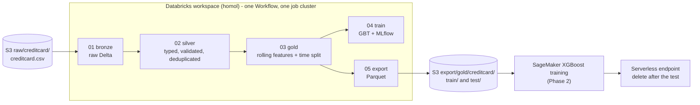

# databricks-sagemaker-fraud-pipeline

**Project 2** of two linked projects. It runs on top of the platform from
[`databricks-aws-terraform-lab`](https://github.com/gil-son/databricks-aws-terraform-lab) (Project 1):
Spark -> Delta Lake (Unity Catalog) -> MLflow -> Parquet export to S3 -> SageMaker training and endpoint.

The platform side (workspace, catalogs, grants, cluster policies, CI) is documented in Project 1, section 3.10 "Project 2 repository" of its README, which lists what this repository relies on.

Use case: credit card fraud detection (ULB/Worldline dataset, 284,807 transactions, 492 frauds = 0.17%).
Because of the imbalance, models are judged by **AUPRC, precision and recall**, never accuracy.

## Architecture



SageMaker reads the Parquet export, never the Delta tables: reading Delta directly would bypass Unity Catalog permissions.

## Layout

```
databricks.yml            Asset Bundle (target homol)
resources/                Workflow definition (job with 5 tasks)
src/                      Notebooks: 01 bronze, 02 silver, 03 gold, 04 train, 05 export
sagemaker/                Training and deploy scripts (Phase 2, not written yet)
tests/                    Tests (not written yet)
```

## Prerequisites (provided by Project 1)

- Workspace `databricks-homol`, catalog `homol_catalog` with schemas `bronze`, `silver`, `gold`.
- Service principal `databricks-homol-pipeline` with `USE_SCHEMA`, `SELECT`, `MODIFY`, `CREATE_TABLE` on the schemas and read/write on the data external location. It does **not** have `CREATE_MODEL`, so models are logged to MLflow runs and not registered in Unity Catalog yet.
- Cluster policy `databricks-homol-job-policy` (fixed node type, single user, at most 2 workers).
- `creditcard.csv` uploaded to `s3://databricks-homol-data-<databricks-account-id>/raw/creditcard/`.
- **The NAT Gateway must be on** while the job runs (clusters need outbound access). Turn it on in Project 1 (Actions > terraform-apply-homol > Run workflow, tick `enable_nat`) and off afterwards.

## Run it

Install the Databricks CLI (v0.2xx or later), then:

```bash
export DATABRICKS_CLIENT_ID=<client id of the service principal that deploys>
export DATABRICKS_CLIENT_SECRET=<its OAuth secret>
export BUNDLE_VAR_data_bucket=databricks-homol-data-<databricks-account-id>
export BUNDLE_VAR_pipeline_sp_application_id=<application id of databricks-homol-pipeline>

databricks bundle validate -t homol
databricks bundle deploy   -t homol
databricks bundle run fraud_pipeline -t homol
```

Expected: silver has fewer rows than bronze (the public dataset contains exact duplicates), gold has `is_test` split by time, and an MLflow experiment `/Shared/homol/fraud-detection` shows a run with `test_auprc`, `test_precision`, `test_recall`.

## Features (gold)

`amount_log`, `hour_of_day`, `tx_count_5m`, `tx_count_1h`, `amount_mean_1h`, `amount_std_1h`, `amount_zscore_1h`, `amount_ratio_to_mean_1h`, plus the PCA components `V1`-`V28`.
The dataset has no card id, so rolling features run over the whole stream ordered by `Time`, looking only at past transactions (no leakage). The 80/20 train/test split is by time and stored once in `is_test`.

## Status

See `PROGRESS.md`. The notebooks are a first draft and have **not run yet**.
